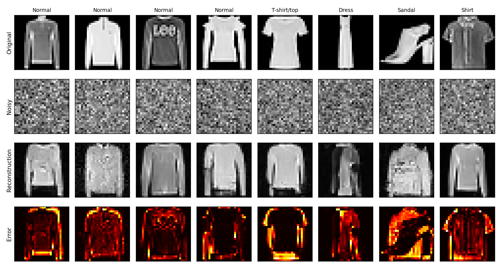
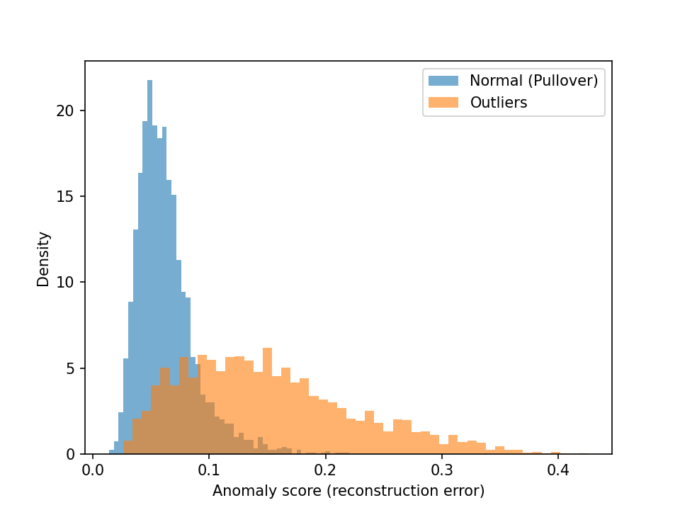
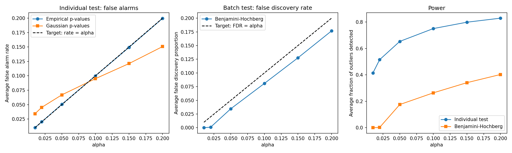

# Outlier detection with a diffusion model and empirical p-values

A diffusion model learns what a normal image looks like.
Its reconstruction error gives an anomaly score.
Empirical p-values turn this score into a test with a guaranteed false alarm rate.

## Setup

- Data: Fashion-MNIST. The normal class is Pullover. The 9 other classes are outliers.
- 4,000 pullovers train the model. 3,000 other pullovers are never seen by the model.
- 500 pullovers and 500 outliers are used only to tune the score.

## Method

**1. Diffusion model.**
A DDPM with a small U-Net is trained on pullovers only.

**2. Anomaly score.**
The image is noised up to step t = 550 (out of 1,000), then denoised with DDIM.
The model only knows pullovers, so it rebuilds a pullover.
The score is the error between the image and its reconstruction.
It is averaged over 5 noisings and computed at 7x7 resolution.

A pullover is rebuilt faithfully. A T-shirt gets long sleeves. A sandal becomes a pullover.

**3. Empirical p-value.**
With $n$ calibration pullovers of scores $s_1, \dots, s_n$, a new image with score $s$ gets

$$p = \frac{1 + \sum_{i=1}^{n} \mathbf{1}(s_i \geq s)}{n + 1}.$$

The image is flagged as an outlier if $p \leq \alpha$.
If the image is normal, its rank among the $n + 1$ scores is uniform.
So $P(p \leq \alpha) \leq \alpha$, whatever the distribution of the scores.

**4. Comparisons.**
The Gaussian p-value assumes the scores are Gaussian.
Benjamini-Hochberg (BH) tests a whole batch and controls the false discovery rate.

## Results

The score reaches an AUROC of 0.890.
The scores of normal images are skewed, with a heavy right tail.

The guarantees are checked over 500 random splits.
Each split has 1,500 calibration pullovers, and a test batch of 1,000 pullovers and 100 outliers.

| α | False alarms (empirical) | False alarms (Gaussian) | Outliers detected |
|---|---|---|---|
| 0.01 | 0.010 | 0.034 | 41% |
| 0.05 | 0.051 | 0.067 | 65% |
| 0.10 | 0.100 | 0.095 | 75% |

- Empirical p-values give exactly α false alarms.
- Gaussian p-values give 3.4 times too many false alarms at α = 0.01. The normal law underestimates the right tail.
- BH keeps the false discovery rate below α, but detects fewer outliers.

## Limitations

- Shoes, bags and trousers are well detected. Shirts and coats are not: they have the same shape as pullovers.
- The smallest p-value is $1/(n+1)$. Multiple testing at small α needs a larger calibration set.
- The guarantee requires the new normal images to come from the same distribution as the calibration images.

## How to run

Open `outlier_detection_diffusion.ipynb` in Google Colab, select a GPU, and run all cells.

## References

- Ho, Jain and Abbeel (2020). Denoising Diffusion Probabilistic Models.
- Song, Meng and Ermon (2021). Denoising Diffusion Implicit Models.
- Wyatt et al. (2022). AnoDDPM: Anomaly Detection with Denoising Diffusion Probabilistic Models.
- Benjamini and Hochberg (1995). Controlling the False Discovery Rate.
- Bates, Candès, Lei, Romano and Sesia (2023). Testing for outliers with conformal p-values.
